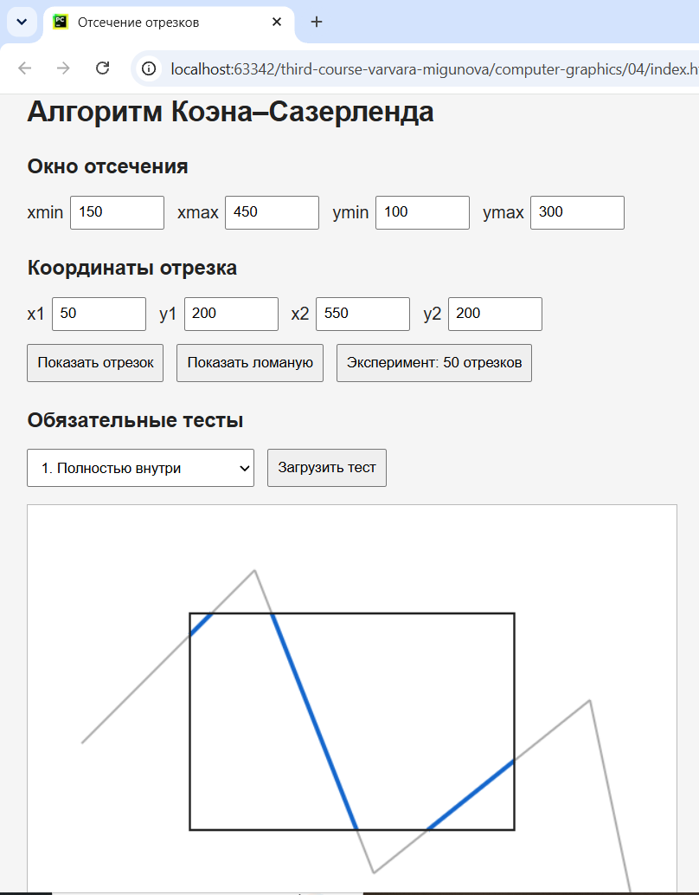
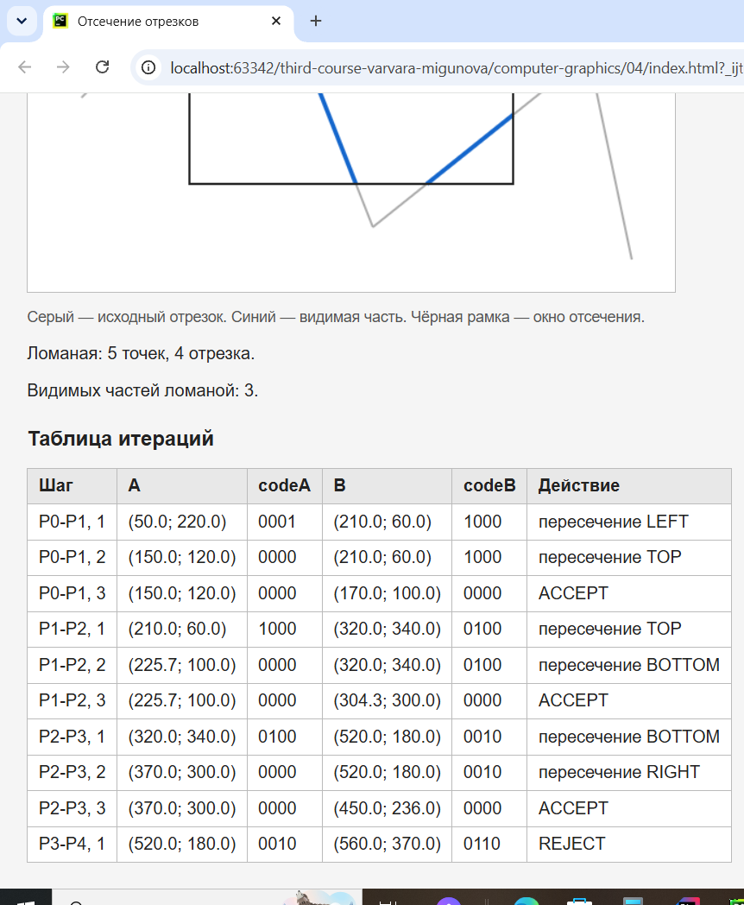

1. Открыть файл index.html в браузере

2. Использовалось окно с координатами xmin = 150, xmax = 450, ymin = 100, ymax = 300.

3. Четырёхбитные коды: 0000 внутри, 0001 слева, 0010 справа, 0100 снизу, 1000 сверху. Если точка находится сразу в двух областях биты объединяются.

4. Все 9 тестов прошли правильно. Отрезки внутри принимались, полностью снаружи отбрасывались, а отрезки, пересекающие окно, обрезались по его границам. Вертикальные и горизонтальные тоже работают.

5. Из 50 случайных отрезков в одном запуске 4 приняли без изменений, 32 отсекли и 14 отбросили. При новом запуске числа могут быть другими, так как отрезки случайные.

Скриншоты

