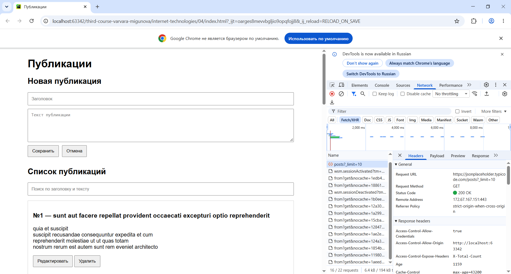
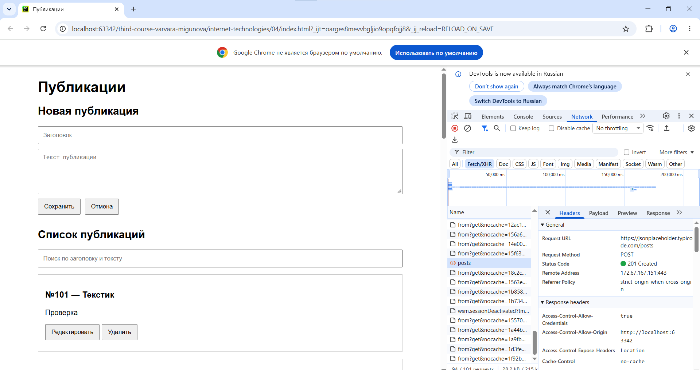
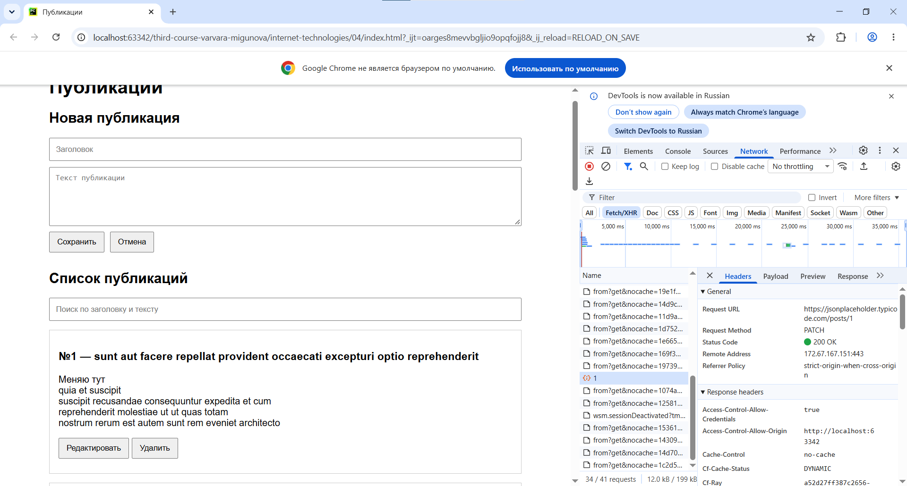
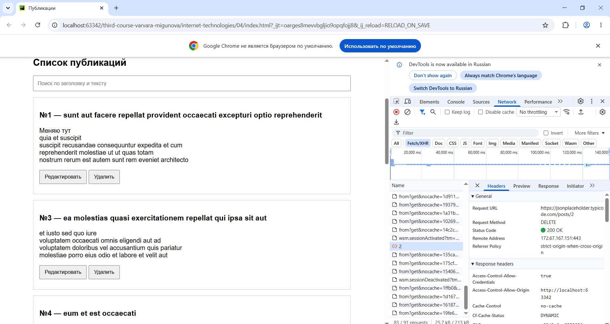

1. JSONPlaceholder
2. GET(получение записей), POST(создание), PATCH(редактирование), DELETE(удаление)
3. Данные хранятся в объекте state:

posts массив публикаций 

isLoading идёт загрузка 

isSaving выполняется создание, редактирование или удаление

error сообщение об ошибке

editingId ID редактируемой публикации (или null при создании).

После изменения state.posts вызывается render(). Поиск работает по уже загруженному массиву без доп. запросов

4. Пустые заголовок и текст отправить нельзя. Если запрос не удался и вышла ошибка, сообщение выводится на странице. Во время выполнения запроса повторное сохранение сделать нельзя.

После успешного POST новая запись добавляется в state.posts, после PATCH обновляется нужная запись, после DELETE она удаляется. Затем вызывается render().

JSONPlaceholder не сохраняет изменения в настоящей базе данных. После перезагрузки страницы всё снова загружается через GET, поэтому созданные записи и изменения пропадают. При создании API обычно возвращает id: 101, даже если создать несколько записей. 

5. После POST запись добавляется в массив, после PATCH изменяется нужная запись, после DELETE она удаляется. Потом интерфейс обновляется.
6. Потому что JSONPlaceholder тестовый, он на самом деле не сохраняет изменения. При перезагрузке данные снова загружаются с сервера.

Скриншоты

