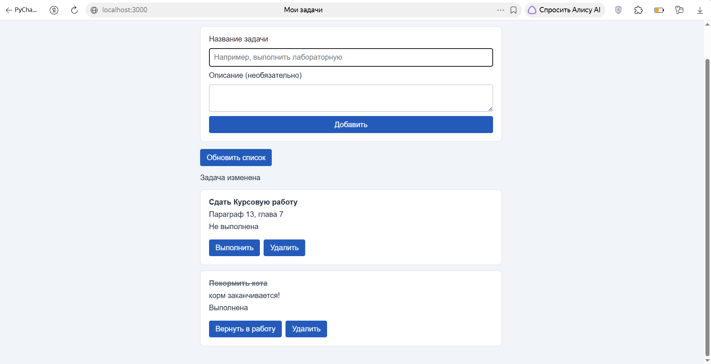
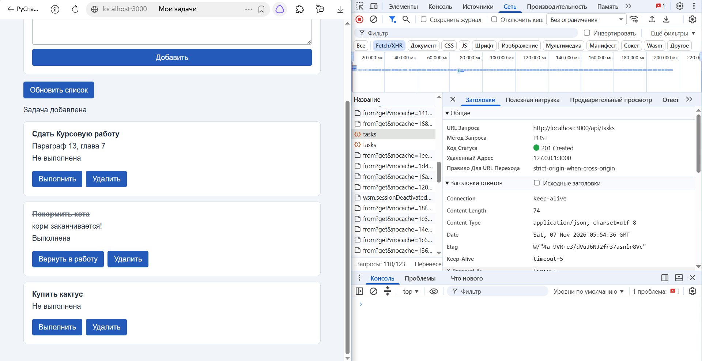
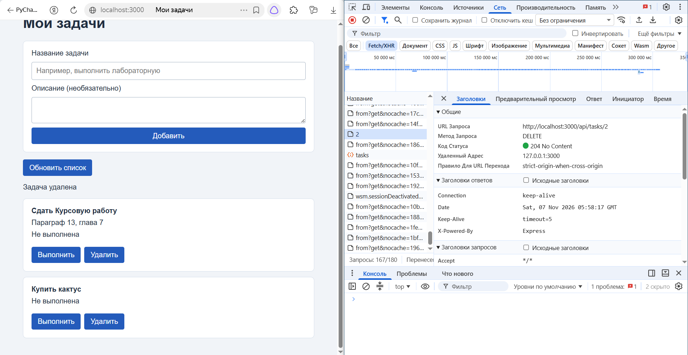

1.1 Установка

Нужен Node.js 22.13 или новее.

1.2 Запуск

В папке 07 выполнить:

npm install

node server.js

Открыть http://localhost:3000.

2. Структура проекта

```text
07/
├── server.js
├── package.json
├── package-lock.json
├── .gitignore
├── README.md
└── public/
    ├── index.html
    ├── style.css
    └── app.js
```

data.db создаётся при запуске

3. Схема обмена

Браузер → fetch → Express → SQL → SQLite → JSON-ответ → обновление страницы.

4. Маршруты API

| Метод | URL | Действие | Статусы |
| --- | --- | --- | --- |
| GET | /api/tasks | Получить список | 200 |
| GET | /api/tasks/:id | Получить задачу | 200, 404 |
| POST | /api/tasks | Создать задачу | 201, 400 |
| PATCH | /api/tasks/:id | Изменить задачу | 200, 400, 404 |
| DELETE | /api/tasks/:id | Удалить задачу | 204, 404 |

5. Действия пользователя в интерфейсе

- Добавление задачи с названием и описанием.
- Изменение признака выполнения.
- Удаление с подтверждением.
- Повторная загрузка списка.

6. Проверки

При подготовке проекта проверены:

| Проверка | Результат |
| --- | --- |
| Пустое название или пробелы | Создание отклонено |
| POST с пустым названием напрямую | 400 |
| Запрос отсутствующей задачи | 404 |
| Успешное удаление | 204, без тела ответа |
| Пустой список | Сообщение «Список пуст» |
| Недоступный сервер | Сообщение об ошибке на странице |
| Название Проверка | Отображается как обычный текст |

При ответе 204 клиент не вызывает response.json(), тк тело ответа пустое.

7. Сохранение данных

Проверено: после создания задачи и перезапуска сервера запись сохраняется в SQLite и снова загружается через API.

8. Используется textContent, тк пользовательский текст выводится без обработки как HTML.


9. Скриншоты





